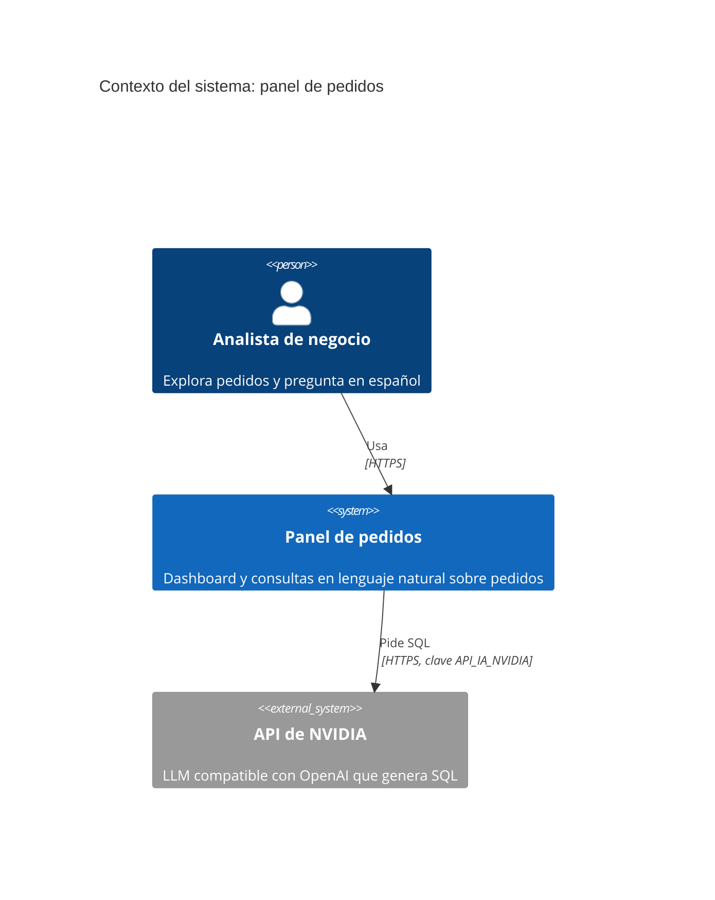
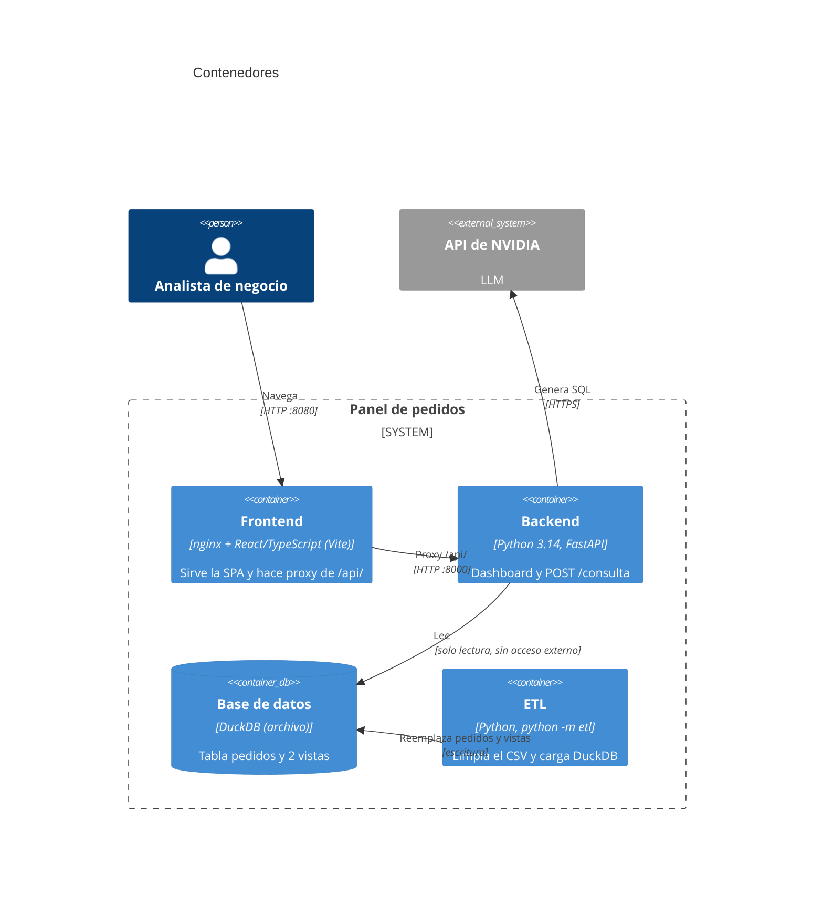
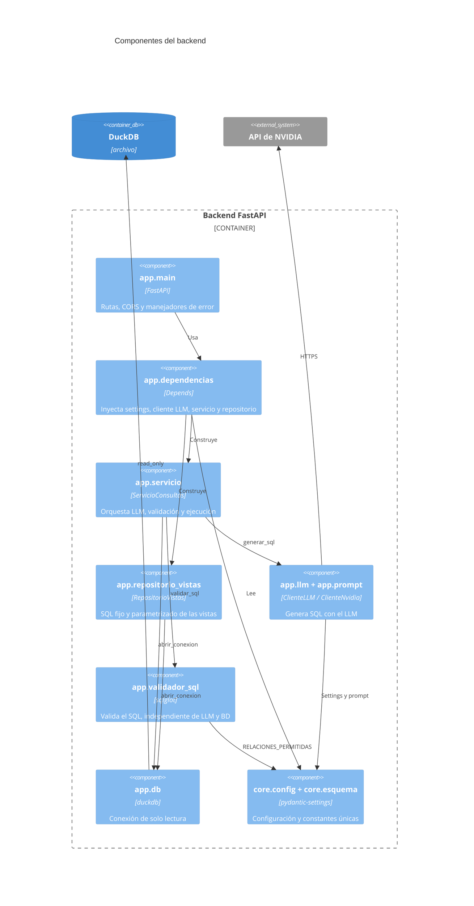
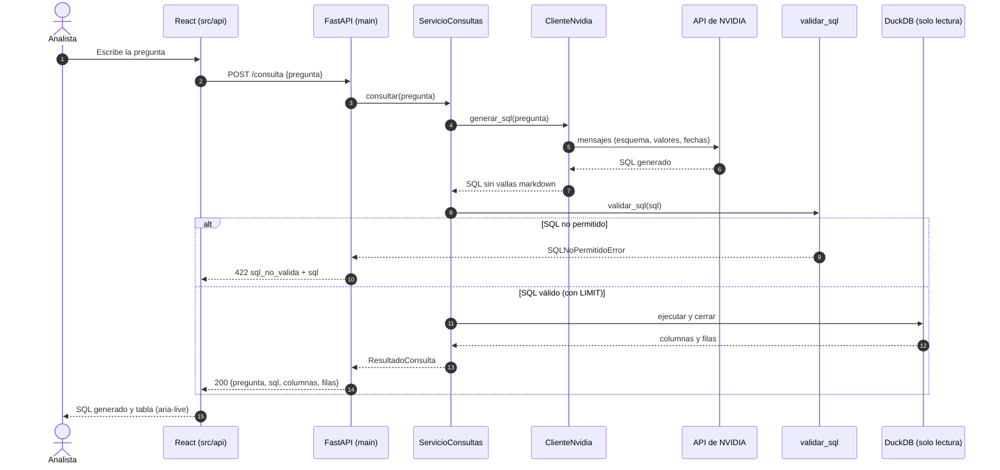
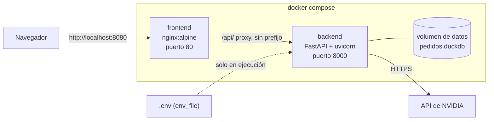

# Arquitectura

Vistas C4 (contexto, contenedores, componentes), secuencia de una consulta y topología de Docker Compose. Complementa a `docs/TRD.md`.

## 1. Contexto (C4 nivel 1)

## 2. Contenedores (C4 nivel 2)

El ETL se ejecuta en el arranque del contenedor backend (`python -m etl --si-falta`) y a mano en desarrollo.

## 3. Componentes del backend (C4 nivel 3)

## 4. Secuencia de una consulta

Los fallos del LLM (502 `llm_error`, 503 `llm_no_configurado`) y de base de datos (503 `base_datos_no_disponible`, 422 `error_ejecucion`) se traducen en `app.main` a `{"error", "mensaje"}`.

Los endpoints del dashboard (`GET /ventas-por-mes-pais`, `GET /top-clientes`) no usan el LLM: `main` llama a `RepositorioVistas`, que abre la conexión de solo lectura y ejecuta SQL fijo.

## 5. Topología de Docker Compose

- El navegador solo habla con `frontend` (8080:80). La imagen se construye con `VITE_API_URL=/api`, así que las llamadas son del mismo origen y no necesitan CORS.
- nginx sirve `dist` con fallback a `index.html` y reenvía `/api/` a `http://backend:8000/` quitando el prefijo.
- `backend` ejecuta `python -m etl --si-falta` y luego uvicorn; su healthcheck consulta `/health`; `frontend` espera a que esté sano (`depends_on`).
- `.env` entra solo como `env_file` en tiempo de ejecución; no se copia a ninguna imagen.
- En desarrollo local no hay nginx: Vite en `:5173` llama a `http://localhost:8000` y se usa CORS (`CORS_ORIGINS`).
