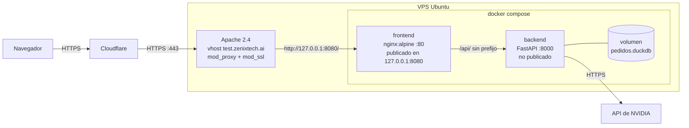

# Despliegue en el VPS (Apache)

Despliegue de pruebas de la aplicación en un VPS propio con **Apache como proxy inverso de entrada**. Complementa la topología de Docker Compose de `docs/ARQUITECTURA.md` (sección 5) y el ADR-9 de `docs/revision-arquitectura.md`.

## 1. Entorno destino

| Elemento | Valor | Cómo se comprobó (2026-11-14) |
|---|---|---|
| Dominio de pruebas | `test.zenixtech.ai` | Indicado por el responsable del proyecto |
| DNS / CDN | Cloudflare con proxy activo (IPs `188.114.96.x`/`188.114.97.x`, cabecera `Server: cloudflare`) | `nslookup` y `curl -I` |
| VPS | Ubuntu con **Apache/2.4.58** escuchando en 80 (redirige a 443) | Cabecera `Server` al pedir por IP |
| Acceso | SSH con las variables `VPS_PROD_USER`, `VPS_PROD_HOST` y `VPS_PROD_PASSWORD` de `.env` | Solo los nombres. Los valores nunca van al repositorio |

> **Nota:** el VPS es compartido (Tequeños, CRM, n8n, Evolution, zenixtech, tntfinances). Antes de este despliegue no existía vhost para `test.zenixtech.ai` y Apache respondía con su vhost por defecto (`crm.tequenosdubai.com`, "Panel de control"). No había otra app que sustituir. Los puertos 8083–8086, 8100–8102 y 5678 ya están en uso; este proyecto usa `127.0.0.1:8080`.

### Estado actual (2026-11-15)

- **Desplegado:** la aplicación real (no la página provisional) está publicada en `https://test.zenixtech.ai` desde la versión `35005f0` de la rama `feat/implementacion`, en `/opt/project-ai-role/releases/35005f0` (enlace `current`). Contenedores `project-ai-role-backend-1` (sano) y `project-ai-role-frontend-1`.
- **Probado en un navegador real:** el panel carga ventas y top de clientes sin errores en consola, y una pregunta en lenguaje natural devuelve el SQL y la tabla (`POST /api/consulta` → `200`).
- **Pendiente:** esa versión es anterior al endurecimiento de seguridad (PR #4). Al fusionar la PR #3 hay que volver a desplegar desde `main`: `python deploy/desplegar.py app --ref main`. El script ya escribe `TRUSTED_HOSTS`, `CORS_ORIGINS` y `CABECERA_IP_CLIENTE` en el `.env` del servidor (sección 5.1); sin `TRUSTED_HOSTS`, esa versión respondería `400` a todo.

## 2. Topología

- **Apache** termina TLS y hace de proxy inverso de todo el vhost hacia `127.0.0.1:8080`. No sirve archivos estáticos ni conoce `/api/`.
- El **nginx del contenedor frontend** se mantiene igual (ADR-5): sirve la SPA y reenvía `/api/` al backend. Así la imagen es la misma en local y en el VPS.
- El puerto del frontend se publica **solo en loopback** (`127.0.0.1:8080:80`) para que no quede accesible saltándose Apache. El backend no publica puertos.
- Cloudflare en modo SSL **Full (strict)**: Apache necesita un certificado válido para el origen (Cloudflare Origin CA o Let's Encrypt).

## 3. Requisitos en el VPS

- Apache 2.4 con los módulos `proxy`, `proxy_http`, `headers`, `ssl`, `rewrite` y `remoteip`:
  `sudo a2enmod proxy proxy_http headers ssl rewrite remoteip`
- Docker Engine con el plugin compose (comprobado: Docker 29.7.1, Compose v5.4.0; Ubuntu 24.04.4).
- Certificado Let's Encrypt en `/etc/letsencrypt/live/test.zenixtech.ai/`. Lo obtiene `desplegar.py vhost` con `certbot certonly --webroot` y se renueva solo. El bloque 443 del vhost va dentro de `<IfFile>`, así que solo se activa cuando existe el certificado.
- Usuario de despliegue con acceso por **clave SSH**. La contraseña de `.env` solo sirve para dar de alta la clave; no debe usarse en scripts.

## 4. Configuración de Apache

El vhost versionado está en `deploy/apache/test.zenixtech.ai.conf`. Se copia a `/etc/apache2/sites-available/` y se activa con `a2ensite`. Puntos clave:

- `ProxyPreserveHost On` y `RequestHeader set X-Forwarded-Proto "https"`.
- `ProxyPass / http://127.0.0.1:8080/` y `ProxyPassReverse` iguales.
- `ProxyTimeout 60`, porque `POST /consulta` espera al LLM.
- El vhost del puerto 80 solo redirige a HTTPS.
- **IP real del cliente:** `mod_remoteip` toma `CF-Connecting-IP` solo si la conexión llega desde los rangos publicados de Cloudflare (`RemoteIPTrustedProxy`). Después, `RequestHeader set X-Cliente-IP "expr=%{REMOTE_ADDR}"` **sobrescribe** cualquier `X-Cliente-IP` que mande el cliente. El backend limita las consultas por esa cabecera (`CABECERA_IP_CLIENTE=X-Cliente-IP`). Si Cloudflare cambia sus rangos, hay que actualizar la lista (https://www.cloudflare.com/ips-v4 y `/ips-v6`).
- **Cabeceras del HTML:** `Strict-Transport-Security: max-age=31536000; includeSubDomains` (siempre, porque solo quien termina TLS puede ponerla), y con `setifempty`, para no pisar las más estrictas de la API: `X-Content-Type-Options`, `X-Frame-Options: DENY`, `Referrer-Policy`, `Permissions-Policy` y una CSP. `setifempty` actúa sobre la tabla `onsuccess`, que es la que ve las cabeceras del backend, pero solo se aplica a respuestas 2xx y 3xx. Los errores de la API (4xx y 5xx, también el 429) reciben HSTS y las cabeceras que pone el propio backend.
- **CSP en modo informe** (`Content-Security-Policy-Report-Only`): Cloudflare inyecta un script en línea (`/cdn-cgi/challenge-platform`) que una CSP estricta bloquearía. Se pasará a `Content-Security-Policy` cuando la consola del navegador no muestre avisos que importen.

## 5. Procedimiento de despliegue

Requisito: existe un `docker-compose.yml` que funciona en local (paso s10 del PLAN) y publica el frontend en `127.0.0.1:8080:80`.

1. En el VPS: `git clone` (o `git pull`) del repositorio en `/opt/project-ai-role`.
2. Copiar el `.env` de ejecución con `scp` (solo `API_IA_NVIDIA` y la configuración de la app; las variables `VPS_PROD_*` no hacen falta en el servidor).
3. `docker compose up -d --build` y esperar a que `backend` esté sano (`docker compose ps`).
4. `curl -fsS http://127.0.0.1:8080/api/health` desde el VPS.
5. Copiar el vhost, `sudo a2ensite test.zenixtech.ai`, `sudo apachectl configtest` y `sudo systemctl reload apache2`.
6. Pruebas de humo desde fuera (sección 6).

### 5.1 Automatización con paramiko (`deploy/`)

Requiere `pip install paramiko`. Los scripts leen `.env` de la raíz (o el de `DEPLOY_ENV` si se trabaja desde un worktree), validan el host con `~/.ssh/known_hosts` y se conectan **solo por clave** (`~/.ssh/id_ed25519_vps`).

| Comando | Qué hace |
|---|---|
| `python deploy/instalar_clave.py` | **Una sola vez, lo ejecuta la persona responsable.** Usa `VPS_PROD_PASSWORD` para añadir la clave pública a `authorized_keys` y comprueba el acceso por clave. |
| `python deploy/desplegar.py preflight` | Solo lectura: SO, Apache y módulos, vhost activos con `test.zenixtech.ai`, Docker, puertos 80/443/8080 y disco. |
| `python deploy/desplegar.py app [--ref <rama>]` | `git archive` de la ref, subida por SFTP a `/opt/project-ai-role/releases/<sha>`, `.env` sin `VPS_*` (modo 600) en `shared/`, al que añade `TRUSTED_HOSTS=test.zenixtech.ai,localhost,127.0.0.1`, `CORS_ORIGINS=https://test.zenixtech.ai` y `CABECERA_IP_CLIENTE=X-Cliente-IP` si el `.env` local no los define, enlace `current` y `docker compose up -d --build`; espera a `/api/health` en `127.0.0.1:8080`. Se niega si la ref no tiene `docker-compose.yml`. |
| `python deploy/desplegar.py vhost [--reemplazar]` | Instala el vhost y los módulos y hace `configtest` y `reload`. Se niega si otro vhost activo ya usa `test.zenixtech.ai`, salvo con `--reemplazar`. Si `configtest` falla, restaura los vhost anteriores sin recargar Apache. |
| `python deploy/desplegar.py humo` | Pruebas de humo locales (8080) y públicas (`https://test.zenixtech.ai`). |

Todas las acciones aceptan `--dry-run`. Vuelta atrás de la app: apuntar `current` a la versión anterior en `releases/` y repetir `docker compose up -d`.

Vuelta atrás: `sudo a2dissite test.zenixtech.ai && sudo systemctl reload apache2` (o reactivar el vhost anterior) y `docker compose down`. Los datos se regeneran con el ETL (`--si-falta`).

## 6. Pruebas de humo

| Prueba | Comando | Resultado esperado |
|---|---|---|
| DNS | `nslookup test.zenixtech.ai` | IPs de Cloudflare |
| Redirección HTTP | `curl -sI http://test.zenixtech.ai` | `301` a `https://` |
| SPA | `curl -s https://test.zenixtech.ai/` | HTML de la app (título del dashboard) |
| Salud del backend | `curl -s https://test.zenixtech.ai/api/health` | `200` con el JSON de `GET /health` (TRD 9.1) |
| Dashboard | `curl -s https://test.zenixtech.ai/api/top-clientes` | `200` con lista de clientes |
| Consulta NL | `curl -s -X POST https://test.zenixtech.ai/api/consulta -H 'Content-Type: application/json' -d '{"pregunta":"ventas totales por país"}'` | `200` con `sql`, `columnas` y `filas` |
| Puerto cerrado | `curl -m 5 http://<ip-vps>:8080/` desde fuera | Sin respuesta (solo loopback) |

### Resultado de la primera prueba (2026-11-14)

- DNS: correcto, resuelve a Cloudflare.
- HTTP: `301` a HTTPS, correcto.
- HTTPS: `200`, pero servía el vhost por defecto del servidor ("Panel de control"). En esa fecha el proyecto aún no estaba desplegado (ver "Estado actual").
- Por IP: el origen responde con `Apache/2.4.58 (Ubuntu)`, lo que confirma Apache en el VPS.
- SSH: el acceso por clave no está configurado (`Permission denied (publickey,password)`). No se entró con contraseña.
- No había nada que desplegar: el repositorio todavía no tiene `docker-compose.yml` (paso s10 pendiente).

### Segunda prueba: cadena completa con página provisional (2026-11-14)

Tras instalar la clave con `instalar_clave.py`:

1. `preflight`: Ubuntu 24.04.4, Apache 2.4.58 con `proxy`, `proxy_http`, `headers`, `ssl` y `rewrite` activos, Docker 29.7.1 / Compose v5.4.0, puerto 8080 libre, sin vhost ni certificado para el dominio.
2. `placeholder`: contenedor `project-ai-role-placeholder` (nginx:alpine) en `127.0.0.1:8080` con una página estática. `app` lo retira antes de levantar compose.
3. `vhost`: `configtest` correcto y `reload`; certificado emitido (caduca el 2027-02-12, renovación automática). Segundo `configtest` correcto y `reload`.
4. `humo` y comprobaciones externas:
   - `http://test.zenixtech.ai` → `301` a HTTPS.
   - `https://test.zenixtech.ai/` → `200` con la página provisional (pasa por Cloudflare → Apache → 127.0.0.1:8080).
   - `/api/health` → `404`, como se espera: aún no hay backend.
   - `http://<ip-vps>:8080/` desde fuera → sin respuesta, solo loopback.
   - Los demás sitios siguen respondiendo igual: tequenosdubai.com, crm, dashboard.zenixtech.ai y n8n con `200`; api.zenixtech.ai con `404` en `/` y `200` en `/health`, como antes.
   - Ajeno a este cambio: el certificado de `tntfinances.com` caducó el 2026-11-04.

### Tercera prueba: cabeceras e IP del cliente (2026-11-15)

Tras `desplegar.py vhost` con el vhost endurecido (`configtest` correcto, `reload`):

- `https://test.zenixtech.ai/` devuelve `Strict-Transport-Security`, `X-Frame-Options: DENY`, `X-Content-Type-Options`, `Referrer-Policy`, `Permissions-Policy` y la CSP en modo informe.
- **Suplantación de IP:** una petición directa al origen (sin pasar por Cloudflare) con `X-Cliente-IP: 6.6.6.6` y `CF-Connecting-IP: 7.7.7.7` llega al contenedor con `X-Cliente-IP: 127.0.0.1`, es decir, la IP real del que conecta. Una petición que sí pasa por Cloudflare llega con la IP real del cliente. Comprobado con `tcpdump` en el puerto 8080 del VPS.
- Los demás sitios del VPS siguen respondiendo `200`.

## 7. Seguridad

- `.env` está en `.gitignore`. Las credenciales del VPS no se copian a imágenes, al servidor ni a los documentos.
- Recomendado: desactivar `PasswordAuthentication` en el VPS una vez dada de alta la clave, y no usar `root` para desplegar.
- **Acceso público sin login:** `test.zenixtech.ai` es accesible por cualquiera y cada pregunta consume la clave de NVIDIA. La autenticación sigue fuera de alcance; como protección, el backend limita `POST /consulta` por IP de cliente y con un tope diario global (ver `docs/TRD.md`). La IP sale de `X-Cliente-IP`, que solo Apache puede fijar.
- **Si hace falta cerrar el entorno de pruebas del todo:** autenticación básica de Apache (`AuthType Basic`) en el vhost, con la contraseña gestionada por el responsable fuera del repositorio.
