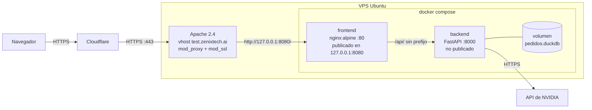

# Despliegue en el VPS (Apache)

Despliegue de pruebas de la aplicación en un VPS propio con **Apache como proxy inverso de entrada**. Complementa la topología de Docker Compose de `docs/ARQUITECTURA.md` (sección 5) y el ADR-9 de `docs/revision-arquitectura.md`.

## 1. Entorno destino

| Elemento | Valor | Cómo se comprobó (2026-11-14) |
|---|---|---|
| Dominio de pruebas | `test.zenixtech.ai` | Indicado por el responsable del proyecto |
| DNS / CDN | Cloudflare con proxy activo (IPs `188.114.96.x`/`188.114.97.x`, cabecera `Server: cloudflare`) | `nslookup` y `curl -I` |
| VPS | Ubuntu con **Apache/2.4.58** escuchando en 80 (redirige a 443) | Cabecera `Server` al pedir por IP |
| Acceso | SSH con las variables `VPS_PROD_USER`, `VPS_PROD_HOST` y `VPS_PROD_PASSWORD` de `.env` | Solo los nombres. Los valores nunca van al repositorio |

> **Aviso:** en la fecha de comprobación `test.zenixtech.ai` ya sirve **otra aplicación** ("Panel de control", con `/api/health` activo). Antes de publicar este proyecto en ese nombre hay que decidir si se sustituye, si se usa otro subdominio (por ejemplo `pedidos.test.zenixtech.ai`) o si se publica bajo una subruta. No se debe sobrescribir el vhost existente sin esa decisión.

## 2. Topología

- **Apache** termina TLS y hace de proxy inverso de todo el vhost hacia `127.0.0.1:8080`. No sirve archivos estáticos ni conoce `/api/`.
- El **nginx del contenedor frontend** se mantiene igual (ADR-5): sirve la SPA y reenvía `/api/` al backend. Así la imagen es la misma en local y en el VPS.
- El puerto del frontend se publica **solo en loopback** (`127.0.0.1:8080:80`) para que no quede accesible saltándose Apache. El backend no publica puertos.
- Cloudflare en modo SSL **Full (strict)**: Apache necesita un certificado válido para el origen (Cloudflare Origin CA o Let's Encrypt).

## 3. Requisitos en el VPS

- Apache 2.4 con los módulos `proxy`, `proxy_http`, `headers`, `ssl` y `rewrite`:
  `sudo a2enmod proxy proxy_http headers ssl rewrite`
- Docker Engine con el plugin compose v2 o superior (pendiente de comprobar en el VPS).
- Certificado del origen para `test.zenixtech.ai` en `/etc/ssl/` (o `certbot --apache`).
- Usuario de despliegue con acceso por **clave SSH**. La contraseña de `.env` solo sirve para dar de alta la clave; no debe usarse en scripts.

## 4. Configuración de Apache

El vhost versionado está en `deploy/apache/test.zenixtech.ai.conf`. Se copia a `/etc/apache2/sites-available/` y se activa con `a2ensite`. Puntos clave:

- `ProxyPreserveHost On` y `RequestHeader set X-Forwarded-Proto "https"`.
- `ProxyPass / http://127.0.0.1:8080/` y `ProxyPassReverse` iguales.
- `ProxyTimeout 60`, porque `POST /consulta` espera al LLM.
- El vhost del puerto 80 solo redirige a HTTPS.

## 5. Procedimiento de despliegue

Requisito: existe un `docker-compose.yml` que funciona en local (paso s10 del PLAN) y publica el frontend en `127.0.0.1:8080:80`.

1. En el VPS: `git clone` (o `git pull`) del repositorio en `/opt/project-ai-role`.
2. Copiar el `.env` de ejecución con `scp` (solo `API_IA_NVIDIA` y la configuración de la app; las variables `VPS_PROD_*` no hacen falta en el servidor).
3. `docker compose up -d --build` y esperar a que `backend` esté sano (`docker compose ps`).
4. `curl -fsS http://127.0.0.1:8080/api/health` desde el VPS.
5. Copiar el vhost, `sudo a2ensite test.zenixtech.ai`, `sudo apachectl configtest` y `sudo systemctl reload apache2`.
6. Pruebas de humo desde fuera (sección 6).

Vuelta atrás: `sudo a2dissite test.zenixtech.ai && sudo systemctl reload apache2` (o reactivar el vhost anterior) y `docker compose down`. Los datos se regeneran con el ETL (`--si-falta`).

## 6. Pruebas de humo

| Prueba | Comando | Resultado esperado |
|---|---|---|
| DNS | `nslookup test.zenixtech.ai` | IPs de Cloudflare |
| Redirección HTTP | `curl -sI http://test.zenixtech.ai` | `301` a `https://` |
| SPA | `curl -s https://test.zenixtech.ai/` | HTML de la app (título del dashboard) |
| Salud del backend | `curl -s https://test.zenixtech.ai/api/health` | `200` con el JSON de `GET /health` (TRD 9.1) |
| Dashboard | `curl -s https://test.zenixtech.ai/api/top-clientes` | `200` con lista de clientes |
| Consulta NL | `curl -s -X POST https://test.zenixtech.ai/api/consulta -H 'Content-Type: application/json' -d '{"pregunta":"ventas totales por país"}'` | `200` con `sql`, `columnas` y `filas` |
| Puerto cerrado | `curl -m 5 http://<ip-vps>:8080/` desde fuera | Sin respuesta (solo loopback) |

### Resultado de la primera prueba (2026-11-14)

- DNS: correcto, resuelve a Cloudflare.
- HTTP: `301` a HTTPS, correcto.
- HTTPS: `200`, pero sirve otra aplicación ("Panel de control"). Este proyecto **aún no está desplegado**.
- Por IP: el origen responde con `Apache/2.4.58 (Ubuntu)`, lo que confirma Apache en el VPS.
- SSH: el acceso por clave no está configurado (`Permission denied (publickey,password)`). No se entró con contraseña.
- No había nada que desplegar: el repositorio todavía no tiene `docker-compose.yml` (paso s10 pendiente).

## 7. Seguridad

- `.env` está en `.gitignore`. Las credenciales del VPS no se copian a imágenes, al servidor ni a los documentos.
- Recomendado: desactivar `PasswordAuthentication` en el VPS una vez dada de alta la clave, y no usar `root` para desplegar.
- Puntos abiertos del despliegue público: autenticación y límite de tasa (ver `revision-arquitectura.md`, sección 6). `test.zenixtech.ai` es accesible por cualquiera, así que cada pregunta consume la clave de NVIDIA.
